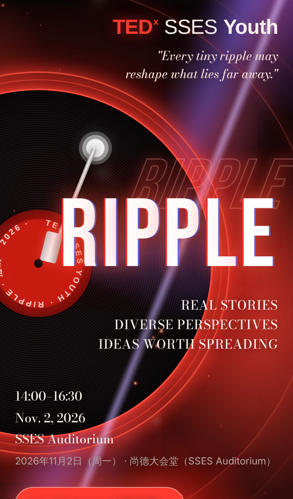
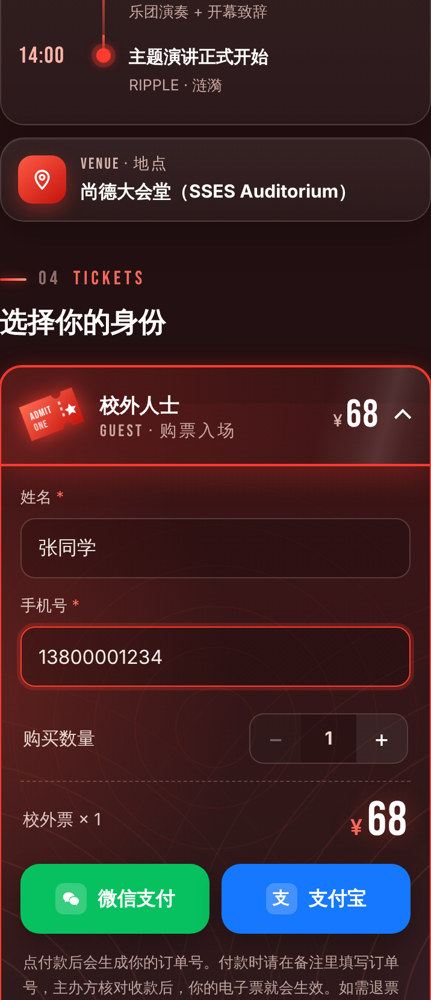
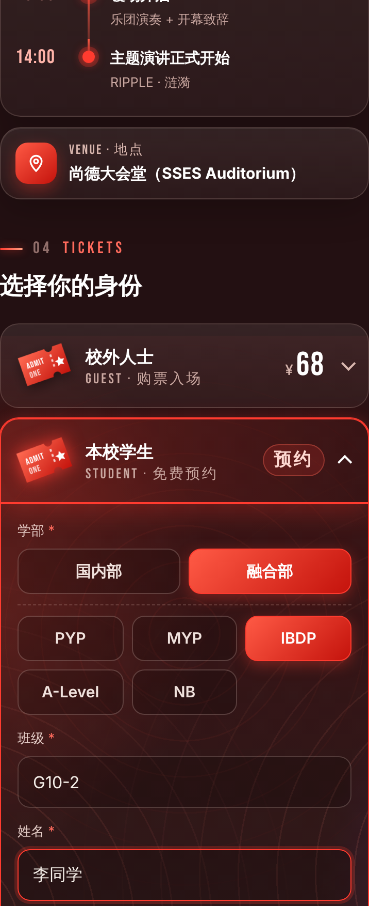
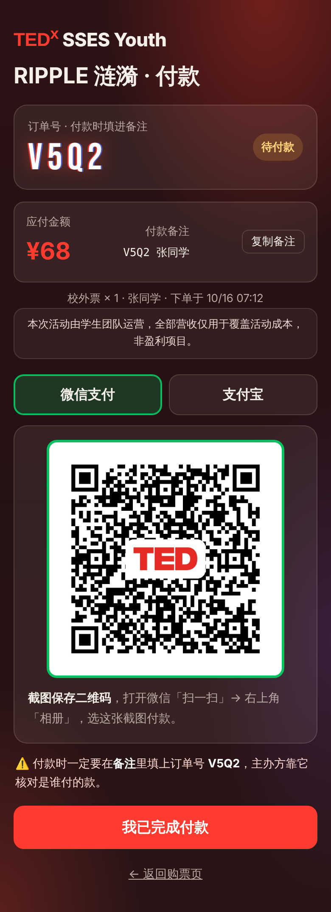
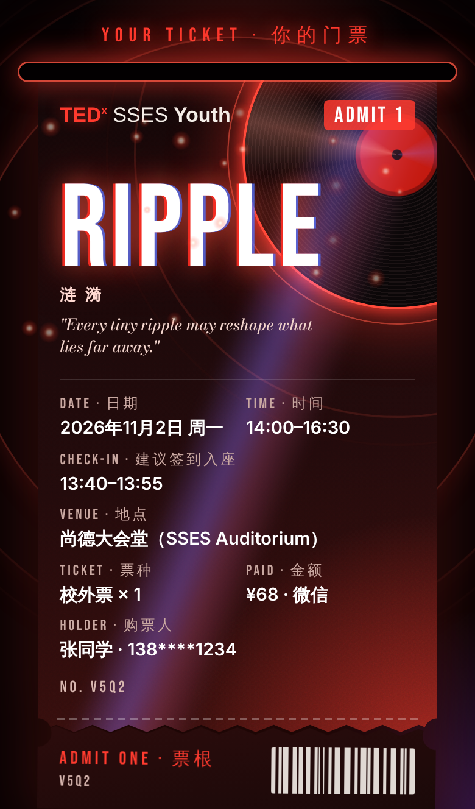
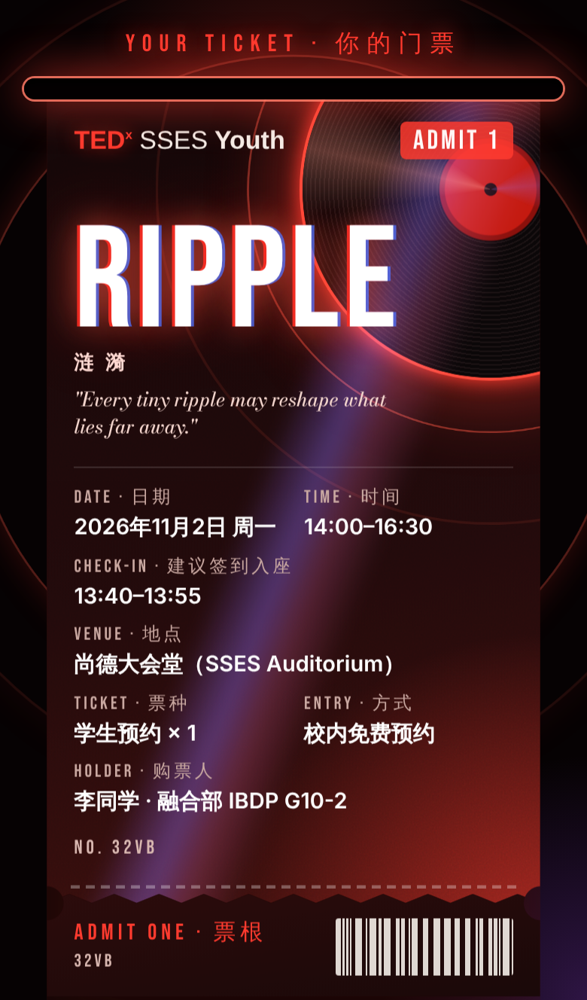
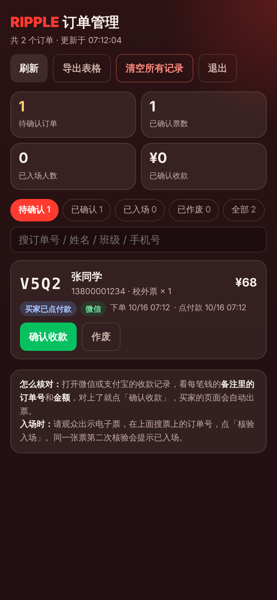

# TEDxSSES Youth · RIPPLE 涟漪 — 购票 / 预约网站

线上地址：https://tedxssesyouth.site

## 界面预览

| 首页 | 校外人士购票 | 本校学生预约 |
| :---: | :---: | :---: |
|  |  |  |

| 付款页（68 元） | 电子票（校外） | 电子票（校内免费预约） |
| :---: | :---: | :---: |
|  |  |  |

| 管理页 |
| :---: |
|  |

截图来自预览模式，里面的姓名、手机号、订单号都是示例数据。

## 目录

| 路径 | 内容 |
| --- | --- |
| `index.html` | 购票页：校外人士购票（68 元）、本校学生 / 老师免费预约 |
| `pay.html` | 付款页 + 出票动画 |
| `admin.html` | 管理页：确认收款、入场核验、作废、导出、清空记录 |
| `config.js` | 活动信息、票种、接口地址 |
| `demo.js` | 本地预览模式（双击打开网页时自动启用，不连腾讯云） |
| `cloudfunction/` | 云函数 `tedx` 的代码和数据库建表语句 |
| `qr/` | 购票页二维码 |
| `screenshots/` | README 里的界面截图 |
| `tedx-site 2/` | 早期版本，已不再使用 |

## 部署

- **网站**：把根目录下的网页文件打成 zip，上传到云开发「静态网站托管」，部署路径 `/`。
  现在部署在新加坡环境 `tedx-sg`，自定义域名 `tedxssesyouth.site`。
- **云函数**：把 `cloudfunction/index.js` 和 `cloudfunction/package.json` 打成 zip，上传到上海环境 `tedx` 的云函数 `tedx`，并选择自动安装依赖。
- **数据库**：上海环境的 PostgreSQL，在 SQL 编辑器里运行一次 `cloudfunction/建表SQL.sql`。

## 云函数环境变量（只填在云函数里，不要写进代码或网页）

- `ADMIN_KEY`：管理页登录密码
- `CLOUDBASE_API_KEY`：云开发 API Key，云函数用它读写数据库
- `PURGE_KEY`：清空所有记录时要输入的密码（可选，不填则使用代码里的默认值）

## 修改票价 / 票种

`config.js` 里的 `tickets` 和 `cloudfunction/index.js` 顶部的 `TICKETS` 要一起改，两边保持一致。
